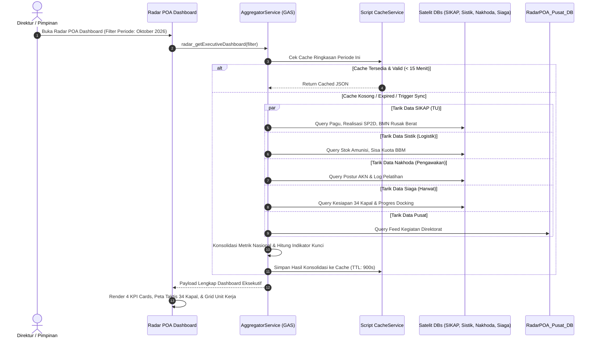

# MASTER ARCHITECTURE & IMPLEMENTATION PLAN
# Transformasi Arsitektur Terdistribusi: Radar POA & Ekosistem Aplikasi Satelit Divisi (SIKAP, Sistik, Nakhoda, Siaga)

> **Status Dokumen**: Rencana Induk Pengembangan (Master Blueprint)  
> **Versi**: 2.1.0 (Penetapan Nomenklatur Aplikasi Satelit: SIKAP, Sistik, Nakhoda, Siaga)  
> **Tanggal**: 26 Oktober 2026  
> **Otoritas Kebijakan**: Arahan Pimpinan & Restrukturisasi Sistem Informasi Direktorat Pemantauan dan Operasi Armada (Dit. POA - Ditjen PSDKP - KKP)

---

## DAFTAR ISI
1. [Eksekutif & Latar Belakang Rearsitektur](#1-eksekutif--latar-belakang-rearsitektur)
2. [Topologi Arsitektur Terdistribusi & Data Federation](#2-topologi-arsitektur-terdistribusi--data-federation)
3. [Prinsip Desain "Anti-Gabruk" (Context-Driven Modular Input)](#3-prinsip-desain-anti-gabruk-context-driven-modular-input)
4. [Aplikasi Satelit 1: SIKAP — Subbag Tata Usaha (Sistem Informasi Keuangan, Anggaran, dan Kepegawaian)](#4-aplikasi-satelit-1-sikap--subbag-tata-usaha-sistem-informasi-keuangan-anggaran-dan-kepegawaian)
5. [Aplikasi Satelit 2: Sistik — Timja Logistik (Sistem Informasi Logistik)](#5-aplikasi-satelit-2-sistik--timja-logistik-sistem-informasi-logistik)
6. [Aplikasi Satelit 3: Nakhoda — Timja Pengawakan (Naungan Awak Kapal Armada)](#6-aplikasi-satelit-3-nakhoda--timja-pengawakan-naungan-awak-kapal-armada)
7. [Aplikasi Satelit 4: Siaga — Timja Pemeliharaan & Perawatan (Sistem Informasi Armada, Galangan, dan Perawatan)](#7-aplikasi-satelit-4-siaga--timja-pemeliharaan--perawatan-sistem-informasi-armada-galangan-dan-perawatan)
8. [Aplikasi Pusat: Radar POA (Rekapitulasi Data Strategis POA & Kegiatan Direktorat)](#8-aplikasi-pusat-radar-poa-rekapitulasi-data-strategis-poa--kegiatan-direktorat)
9. [Protokol Master Data Bersama & Federated Single Source of Truth](#9-protokol-master-data-bersama--federated-single-source-of-truth)
10. [Desain Antarmuka, Skala Kontrol 3-Tier & Standar Apple HIG](#10-desain-antarmuka-skala-kontrol-3-tier--standar-apple-hig)
11. [Roadmap Implementasi Bertahap (Step-by-Step Dev Plan)](#11-roadmap-implementasi-bertahap-step-by-step-dev-plan)

---

## 1. EKSEKUTIF & LATAR BELAKANG REARSITEKTUR

### 1.1 Perubahan Paradigma Sistem
Berdasarkan arahan pimpinan terbaru Direktorat Pemantauan dan Operasi Armada (Dit. POA), sistem **Nautika** yang semula dirancang sebagai sistem monolitik input terpusat (*central monolithic inputs*) mengalami perubahan arsitektural fundamental:
1. **Desentralisasi Input ke 4 Aplikasi Satelit Mandiri**: Setiap unit kerja / tim kerja memiliki aplikasi mandiri (*dedicated web app*) dengan identitas resmi:
   - **SIKAP** (*Sistem Informasi Keuangan, Anggaran, dan Kepegawaian*) untuk Subbag Tata Usaha.
   - **Sistik** (*Sistem Informasi Logistik*) untuk Timja Logistik.
   - **Nakhoda** (*Naungan Awak Kapal Armada*) untuk Timja Pengawakan.
   - **Siaga** (*Sistem Informasi Armada, Galangan, dan Perawatan*) untuk Timja Pemeliharaan & Perawatan (Harwat).
   Masing-masing aplikasi beroperasi dengan basis data Google Sheets dan Google Drive folder terisolasi untuk mengeliminasi masalah *lock-contention* (konflik `LockService`), batasan ukuran sel Google Sheets, serta campur aduk hak akses staf teknis.
2. **Transformasi Nautika menjadi "Radar POA"**: Nautika berganti nama menjadi **Radar POA (Rekapitulasi Data Strategis POA)**. Fungsinya beralih menjadi **Aggregator Dashboard Eksekutif Murni** yang mengonsolidasi seluruh data dari 4 aplikasi satelit mandiri dan data mart pelaporan Looker Studio.
3. **Penyatuan Kegiatan Direktorat di Radar POA**: Seluruh pelaporan kegiatan pimpinan dan lintas-direktorat (*pre-award meeting*, monitoring ABT pimpinan, serah terima, dsb.) secara eksklusif diinput langsung di dalam **Radar POA** melalui modul feed interaktif.
4. **Penyesuaian Scope Pengembang (Batas Tanggung Jawab)**: Modul *Operasi Laut*, *Operasi Udara*, *Intelijen*, dan *Pelayanan / Pemantauan* dikerjakan secara independen oleh tim pengembang lain. Seluruh fase pasca-18 pada rencana lama yang terkait modul-modul tersebut resmi dikeluarkan dari *developer roadmap* ini. Radar POA hanya menyediakan *data ingestion interface* (penarikan data) dari spreadsheet yang dihasilkan tim tersebut.

### 1.2 Matriks Ruang Lingkup Sistem Baru

| Aplikasi / Subsistem | Nama Resmi & Kepanjangan | Peran Utama | Sumber Data Primer | Input Yang Dikelola | Hak Akses Input |
|---|---|---|---|---|---|
| **SIKAP** | **S**istem **I**nformasi **K**euangan, **A**nggaran, dan Ke**P**egawaian | Satelit Input Subbag TU | `RadarPOA_SIKAP_DB` | Realisasi SP2D/Akrual, Paket Pengadaan, Kepegawaian TU, Register BMN Per-Item, Penghapusan BMN | Kadiv TU, Staf Keuangan, Staf BMN, Staf TU |
| **Sistik** | **S**istem **I**nformasi Logi**stik** | Satelit Input Timja Logistik | `RadarPOA_Sistik_DB` | Baseline & Pemakaian Amunisi, Baseline & Realisasi BBM, Komponen Logistik Personil | Kadiv Logistik, Staf Logistik |
| **Nakhoda** | **Na**ungan Awak **K**apal Armada | Satelit Input Timja Pengawakan | `RadarPOA_Nakhoda_DB` | Komposisi AKN Keseluruhan & POA, Log Kegiatan Personil / Diklat / Bimtek | Kadiv Pengawakan, Staf Pengawakan |
| **Siaga** | **S**istem **I**nformasi **A**rmada, **G**alangan, dan Per**A**watan | Satelit Input Timja Harwat | `RadarPOA_Siaga_DB` | Status Kesiapan Armada Kapal (Laik Laut), Monitoring Tahap Docking, Item Pekerjaan Harwat | Kadiv Harwat, Staf Perawatan |
| **Radar POA** | **R**ekapitulasi D**a**ta Strategis **P**OA | **Central Aggregator & Strategic Dashboard** | Konsolidasi Seluruh Satelit + `RadarPOA_Pusat_DB` | **Kegiatan Direktorat (Lintas Unit)** + Eksekutif View | Direktur, Superadmin, Seluruh Kadiv |
| *Modul Eksternal* | *Operasi Laut/Udara, Intelijen, Pelayanan* | *External Ingestion* | *Spreadsheet Tim Eksternal* | *Dikerjakan tim lain; Radar POA hanya membaca hasil rekapitulasinya* | *Dikelola tim eksternal* |

---

## 2. TOPOLOGI ARSITEKTUR TERDISTRIBUSI & DATA FEDERATION

### 2.1 Diagram Arsitektur Ekosistem Radar POA

```mermaid
flowchart TB
    subgraph SATELLITE_APPS["APLIKASI SATELIT MANDIRI (INPUT DIVISI)"]
        subgraph APP_SIKAP["1. SIKAP (Subbag Tata Usaha)<br/>Sistem Informasi Keuangan, Anggaran, & Kepegawaian"]
            SIKAP_UI["UI Form Anti-Gabruk<br/>(SP2D | Paket | Pegawai | BMN | Hapus)"]
            SIKAP_GAS["Apps Script Engine: SIKAP"]
            SIKAP_DB[("Spreadsheet:<br/>RadarPOA_SIKAP_DB")]
            SIKAP_DRIVE[("Drive Folder:<br/>Evidence SIKAP & BMN")]
            SIKAP_UI --> SIKAP_GAS --> SIKAP_DB
            SIKAP_GAS --> SIKAP_DRIVE
        end

        subgraph APP_SISTIK["2. Sistik (Timja Logistik)<br/>Sistem Informasi Logistik"]
            SISTIK_UI["UI Form Anti-Gabruk<br/>(Amunisi | BBM | Personil)"]
            SISTIK_GAS["Apps Script Engine: Sistik"]
            SISTIK_DB[("Spreadsheet:<br/>RadarPOA_Sistik_DB")]
            SISTIK_UI --> SISTIK_GAS --> SISTIK_DB
        end

        subgraph APP_NAKHODA["3. Nakhoda (Timja Pengawakan)<br/>Naungan Awak Kapal Armada"]
            NAKHODA_UI["UI Form Anti-Gabruk<br/>(Komposisi AKN | Kegiatan)"]
            NAKHODA_GAS["Apps Script Engine: Nakhoda"]
            NAKHODA_DB[("Spreadsheet:<br/>RadarPOA_Nakhoda_DB")]
            NAKHODA_UI --> NAKHODA_GAS --> NAKHODA_DB
        end

        subgraph APP_SIAGA["4. Siaga (Timja Harwat)<br/>Sistem Informasi Armada, Galangan, & Perawatan"]
            SIAGA_UI["UI Form Anti-Gabruk<br/>(Kesiapan | Docking | Pekerjaan)"]
            SIAGA_GAS["Apps Script Engine: Siaga"]
            SIAGA_DB[("Spreadsheet:<br/>RadarPOA_Siaga_DB")]
            SIAGA_DRIVE[("Drive Folder:<br/>Evidence Siaga & Docking")]
            SIAGA_UI --> SIAGA_GAS --> SIAGA_DB
            SIAGA_GAS --> SIAGA_DRIVE
        end
    end

    subgraph EXTERNAL_APPS["SUBSISTEM EKSTERNAL (TIM LAIN)"]
        EXT_OPS[("Spreadsheet Operasi Laut & Udara")]
        EXT_INT[("Spreadsheet Intelijen")]
        EXT_SRV[("Spreadsheet Pelayanan VMS")]
    end

    subgraph MASTER_DATA_HUB["FEDERATED MASTER DATA HUB"]
        MST_DB[("Spreadsheet:<br/>RadarPOA_Master_DB<br/>(Kapal 34 Besar | WPP | UPT | Opsi Enum)")]
    end

    MST_DB -.->|Shared Read-Only| APP_SIKAP
    MST_DB -.->|Shared Read-Only| APP_SISTIK
    MST_DB -.->|Shared Read-Only| APP_NAKHODA
    MST_DB -.->|Shared Read-Only| APP_SIAGA

    subgraph CENTRAL_AGGREGATOR["RADAR POA (PUSAT AGREGASI & MONITORING STRATEGIS)"]
        RADAR_UI["Executive Dashboard (SiMata Style)<br/>- 4 Top KPI Cards<br/>- Peta Taktis 34 Kapal Besar<br/>- Grid Monitoring 8 Unit Kerja<br/>- Feed Kegiatan Direktorat"]
        RADAR_KGD_FORM["Modal Input Khusus:<br/>Form Kegiatan Direktorat"]
        RADAR_ENGINE["Aggregator Engine & Cache Service<br/>(Cross-Spreadsheet Reader)"]
        RADAR_DB[("Spreadsheet:<br/>RadarPOA_Pusat_DB<br/>(TX_KegiatanDirektorat, Logs)")]
        RADAR_DRIVE[("Drive Folder:<br/>Evidence Kegiatan Pimpinan")]
        
        RADAR_KGD_FORM --> RADAR_ENGINE
        RADAR_UI --> RADAR_ENGINE
        RADAR_ENGINE --> RADAR_DB
        RADAR_ENGINE --> RADAR_DRIVE
    end

    SIKAP_DB ==>|Aggregated Ingestion| RADAR_ENGINE
    SISTIK_DB ==>|Aggregated Ingestion| RADAR_ENGINE
    NAKHODA_DB ==>|Aggregated Ingestion| RADAR_ENGINE
    SIAGA_DB ==>|Aggregated Ingestion| RADAR_ENGINE
    EXT_OPS -.->|External Pull| RADAR_ENGINE
    EXT_INT -.->|External Pull| RADAR_ENGINE
    EXT_SRV -.->|External Pull| RADAR_ENGINE

    subgraph REPORTING_PIPELINE["DATA MART & REPORTING"]
        LOOKER_DB[("Spreadsheet:<br/>RadarPOA_Looker_Mart")]
        LOOKER_STUDIO["Looker Studio Executive Dashboard & PDF Scheduled Export"]
        RADAR_ENGINE ==>|Scheduled ETL Batch| LOOKER_DB --> LOOKER_STUDIO
    end
```



### 2.2 Mekanisme Penarikan Data (Cross-Spreadsheet Federation)
Agar Radar POA dapat menyajikan data agregasi dengan responsivitas tinggi (< 1,5 detik) tanpa terkendala kuota eksekusi Google Apps Script:
1. **Direct Spreadsheet Federation via `SpreadsheetApp.openById(sheetId)`**:
   - Akun *service execution* Radar POA diberikan hak akses *Viewer / Editor* ke Spreadsheet masing-masing satelit (`RadarPOA_SIKAP_DB`, `RadarPOA_Sistik_DB`, `RadarPOA_Nakhoda_DB`, `RadarPOA_Siaga_DB`).
   - Pemanfaatan `Range.getValues()` secara masif (batch-array) pada sheet transaksi aktif (`Status == 'ACTIVE'`).
2. **Aggregator Memory Caching (`CacheService`)**:
   - Radar POA menerapkan cache in-memory 10-15 menit untuk ringkasan KPI eksekutif menggunakan `CacheService.getScriptCache()`.
   - Tombol manual **"Sinkronkan Data" / "Sync Now"** di toolbar atas Radar POA untuk melakukan *cache-bust* seketika jika pimpinan membutuhkan angka paling mutakhir.
3. **Atomic Write Isolation**:
   - Setiap transaksi input di aplikasi satelit hanya mengunci (`LockService.getScriptLock()`) spreadsheet miliknya sendiri. Tidak ada interlock global yang memblokir user lain di divisi berbeda.

---

## 3. PRINSIP DESAIN "ANTI-GABRUK" (CONTEXT-DRIVEN MODULAR INPUT)

Sesuai instruksi mutlak user: **"Input di tiap aplikasi tidak gabrek semua, ada input untuk A, untuk B, untuk C, dkk jadi jangan gabrug"**.

### 3.1 Aturan Emas Arsitektur Form (Anti-Gabruk Rules)
1. **Dilarang Form Monolitik Raksasa**: Dilarang menggabungkan field dari domain tanggung jawab yang berbeda ke dalam satu formulir submission panjang.
2. **One Context, One Sub-Form, One Action**: Setiap entitas bisnis memiliki form modal / panel input tersendiri dengan tombol submit independen.
   - Contoh di SIKAP (Tata Usaha): Penginputan realisasi SP2D dilakukan di form khusus Keuangan; Penginputan aset BMN dilakukan di form khusus BMN. Keduanya tidak boleh berada dalam satu form submit mingguan yang dipaksa bersamaan.
3. **Dedicated Sub-Navigation & Tab Segmentation**: Di dalam setiap aplikasi satelit, antarmuka dibagi menjadi tab atau sub-halaman yang jelas sesuai tugas fungsi masing-masing personil.
4. **Isolated Validation & Error Boundary**: Kesalahan validasi pada Sub-Form A tidak boleh merusak atau menggagalkan penyimpanan Sub-Form B.
5. **Granular Historical Audit Trail**: Setiap sub-input memiliki riwayat revisi dan pembatalan (*anulir*) masing-masing, sehingga memudahkan pelacakan akuntabilitas (*siapa mengubah apa dan kapan*).

---

## 4. APLIKASI SATELIT 1: SIKAP — SUBBAG TATA USAHA (SISTEM INFORMASI KEUANGAN, ANGGARAN, DAN KEPEGAWAIAN)

### 4.1 Gambaran Umum & Basis Data
- **Nama Aplikasi Resmi**: **SIKAP** (*Sistem Informasi Keuangan, Anggaran, dan Kepegawaian*)
- **Unit Kerja**: Subbag Tata Usaha
- **Spreadsheet Dedicated**: `RadarPOA_SIKAP_DB`
- **Google Drive Folder**: `POA_Evidence_SIKAP`
- **Peran**: Pusat tata kelola sumber daya manajerial Direktorat (anggaran kas, pengadaan paket, SDM aparatur, dan aset fisik BMN).

### 4.2 Struktur Modular "Anti-Gabruk" (5 Sub-Modul Input Terpisah)

```
APLIKASI SIKAP (SUBBAG TATA USAHA)
├── [Sub-Modul A] Input Realisasi Anggaran (SP2D & Akrual)
├── [Sub-Modul B] Input Progres Paket Pekerjaan & Pengadaan
├── [Sub-Modul C] Input Manajemen Kepegawaian & Headcount
├── [Sub-Modul D] Input Inventaris Aset Fisik BMN (Anti-Jebret)
└── [Sub-Modul E] Input Berkas Usulan Penghapusan Aset BMN
```

---

#### 4.2.1 Sub-Modul A: Input Realisasi Anggaran (SP2D & Akrual)
Mengelola realisasi keuangan kas negara secara mingguan dengan pemisahan tegas Pagu Reguler vs ABT.

- **Trigger / Akses**: Tab "Keuangan & Anggaran" -> Tombol "Update Realisasi Anggaran".
- **Struktur Field Input Form**:
  | Field | Tipe Kontrol | Aturan Validasi |
  |---|---|---|
  | `Periode` | Dropdown (Tahun-Bulan-Minggu) | Wajib, default minggu berjalan |
  | `PaguReguler` | Currency Input (Rp) | Inherit otomatis dari minggu lalu; editable jika ada revisi pagu |
  | `PaguABT` | Currency Input (Rp) | Inherit otomatis dari minggu lalu; editable jika ada revisi pagu |
  | `CatatanRevisiPagu` | Textarea | Wajib diisi jika nilai PaguReguler / PaguABT berubah dari periode sebelumnya |
  | `RealisasiSP2D_Reguler_Minggu` | Currency Input (Rp) | Wajib $\ge 0$, realisasi kas cair SP2D minggu ini |
  | `RealisasiSP2D_ABT_Minggu` | Currency Input (Rp) | Wajib $\ge 0$, realisasi kas cair SP2D ABT minggu ini |
  | `RealisasiAkrual_Reguler_Minggu` | Currency Input (Rp) | Wajib $\ge 0$, komitmen pekerjaan selesai minggu ini |
  | `RealisasiAkrual_ABT_Minggu` | Currency Input (Rp) | Wajib $\ge 0$, komitmen pekerjaan selesai ABT minggu ini |
- **Kalkulasi Otomatis Server-Side**:
  - `PaguTotal = PaguReguler + PaguABT`
  - `AkumulasiSP2D = Σ RealisasiSP2D_Reguler + Σ RealisasiSP2D_ABT`
  - `SisaPagu = PaguTotal - AkumulasiSP2D`
  - `%Serapan = (AkumulasiSP2D / PaguTotal) * 100`

---

#### 4.2.2 Sub-Modul B: Input Progres Paket Pekerjaan & Pengadaan
Mengelola siklus pengadaan paket barang, jasa konsultansi, konstruksi, dan pemeliharaan per divisi di lingkup direktorat.

- **Trigger / Akses**: Tab "Monitoring Pengadaan" -> Tombol "Catat Progres Paket".
- **Struktur Field Input Form**:
  | Field | Tipe Kontrol | Aturan Validasi |
  |---|---|---|
  | `PaketID` | Dropdown Relasional | Mengambil dari `Master_Paket` aktif |
  | `TahapPekerjaan` | Select Enum | `PERSIAPAN`, `PEMILIHAN`, `KONTRAK`, `PELAKSANAAN`, `BAST`, `SELESAI` |
  | `NomorKontrak` | Text Input | Wajib jika tahap $\ge$ KONTRAK |
  | `NilaiKontrak` | Currency Input (Rp) | Wajib jika tahap $\ge$ KONTRAK |
  | `RekananPenyedia` | Text Input | Nama PT/CV vendor penyedia |
  | `ProgresFisikPct` | Number Slider / Input (%) | 0 s.d. 100% |
  | `RealisasiKeuangan` | Currency Input (Rp) | Nilai termin/dana yang telah dibayarkan |
  | `KendalaKeterangan` | Textarea | Opsional, catatan hambatan di lapangan |
  | `EvidenceUrl` | File Upload / Drive Link | Dokumen kontrak / BAST / Foto fisik |

---

#### 4.2.3 Sub-Modul C: Input Manajemen Kepegawaian & Headcount
Mencatat komposisi aparatur sipil dan personil pendukung di Subbag TU secara snapshot carry-forward.

- **Trigger / Akses**: Tab "Kepegawaian" -> Tombol "Update Headcount Pegawai".
- **Struktur Field Input Form (Grid Form Individual)**:
  | Kategori Aparatur | Tipe Kontrol | Deskripsi |
  |---|---|---|
  | `PNS` | Number Input ($\ge 0$) | Pegawai Negeri Sipil aktif |
  | `P3K` | Number Input ($\ge 0$) | PPPK Penuh Waktu |
  | `P3K_PARUH_WAKTU` | Number Input ($\ge 0$) | Kebijakan MenPAN-RB terbaru |
  | `PJLP` | Number Input ($\ge 0$) | Tenaga Honorer / Penyedia Jasa Lainnya Perorangan |
  | `MAGANG` | Number Input ($\ge 0$) | Siswa / Mahasiswa Magang Resmi PKL |
  | `KeteranganMutasi` | Textarea | Catatan mutasi (promosi, pensiun, rotasi) |

---

#### 4.2.4 Sub-Modul D: Input Inventaris Aset Fisik BMN (Anti-Jebret / Per-Unit)
Mengelola pendaftaran aset operasional dan neraca secara granular (1 unit fisik = 1 baris transaksi). Dilarang keras input global curah!

- **Trigger / Akses**: Tab "Inventaris BMN" -> Tombol "Daftarkan Unit Aset Baru" atau "Smart Bulk Import SAKTI".
- **Struktur Field Input Form Single Aset**:
  | Field | Tipe Kontrol | Aturan Validasi |
  |---|---|---|
  | `KodeBarang` | Text Input (10 digit) | Sesuai katalog Kemenkeu SAKTI |
  | `NUP` | Number Input | Nomor Urut Pendaftaran unik per kode barang |
  | `NamaBarang` | Text Input | Nama resmi barang inventaris |
  | `MerekTipe` | Text Input | Spesifikasi pabrikan / tipe |
  | `KategoriPencatatan` | Select Enum | `BUKU` (Intrakomptabel $\ge$ kapitalisasi) vs `REGULER` (Ekstrakomptabel) |
  | `KodeKategori` | Dropdown Master | Relasi ke `Master_BMN_Kategori` (untuk acuan masa manfaat) |
  | `TanggalPerolehan` | Date Picker | Tanggal pembelian / BAST perolehan |
  | `NilaiPerolehan` | Currency Input (Rp) | Nilai perolehan kotor |
  | `NilaiBuku` | Currency Input (Rp) | Nilai buku terkini dari SAKTI |
  | `Kondisi` | Segmented Control | `BAIK`, `RUSAK_RINGAN`, `RUSAK_BERAT` |
  | `FotoEvidence` | Direct Camera / File Upload | Foto fisik aset unit bersangkutan |
  | `LokasiPangkalan` | Dropdown Master | Lokasi UPT / Pangkalan penempatan |
  | `LokasiDetailRuangan` | Text Input | Contoh: "Gudang Senjata Lt. 2", "Anjungan Kapal Orca 01" |
- **Pipeline Otomatis Geotagging 2-Opsi**:
  1. *Opsi 1*: Ekstraksi EXIF GPS dari metadata foto mentah sebelum kompresi.
  2. *Opsi 2*: Fallback koordinat GPS browser pengguna (`navigator.geolocation`) atau koordinat Homebase profil staf.
  3. *Haversine Resolver*: Server menghitung jarak ke UPT terdekat secara otomatis.

---

#### 4.2.5 Sub-Modul E: Input Berkas Usulan Penghapusan Aset BMN
Mengelola siklus legalitas pemusnahan/lelang aset rusak berat sesuai tata kelola Kementerian Keuangan.

- **Trigger / Akses**: Tab "Inventaris BMN" -> Sub-Tab "Penghapusan Aset" -> Tombol "Buat Usulan Penghapusan".
- **Struktur Field Input Form**:
  | Field | Tipe Kontrol | Aturan Validasi |
  |---|---|---|
  | `Tahap` | Select Enum | `DRAFT_USULAN`, `SURAT_USULAN`, `PERSETUJUAN_KEMENKEU`, `SK_PENGHAPUSAN`, `BAST_SELESAI` |
  | `AlasanPenghapusan` | Select Enum | `RUSAK_BERAT`, `KADALUWARSA`, `HILANG`, `HIBAH`, `PENJUALAN_LELANG` |
  | `PilihAsetDiusulkan` | Multi-Select Checkbox Modal | Hanya memfilter aset dengan kondisi `RUSAK_BERAT` |
  | `NomorSuratUsulan` | Text Input | Nomor surat Satker ke Kemenkeu |
  | `TanggalSuratUsulan`| Date Picker | Tanggal surat usulan |
  | `EvidenceSurat` | PDF Upload | File scan surat usulan resmi |
  | `DokumenPersetujuan`| PDF Upload | Scan surat izin DJKN / KPKNL |

---

## 5. APLIKASI SATELIT 2: SISTIK — TIMJA LOGISTIK (SISTEM INFORMASI LOGISTIK)

### 5.1 Gambaran Umum & Basis Data
- **Nama Aplikasi Resmi**: **Sistik** (*Sistem Informasi Logistik*)
- **Unit Kerja**: Timja Logistik
- **Spreadsheet Dedicated**: `RadarPOA_Sistik_DB`
- **Peran**: Pengendalian operasional logistik persenjataan armada, alokasi BBM reguler & ABT kapal pengawas, serta pemenuhan hak logistik personil operasi.

### 5.2 Struktur Modular "Anti-Gabruk" (3 Sub-Modul Input Terpisah)

```
APLIKASI SISTIK (TIMJA LOGISTIK)
├── [Sub-Modul A] Input Logistik Amunisi & Senjata Api
├── [Sub-Modul B] Input Logistik Bahan Bakar Minyak (BBM)
└── [Sub-Modul C] Input Logistik & Hak Operasional Personil
```

---

#### 5.2.1 Sub-Modul A: Input Logistik Amunisi & Senjata Api
Mengelola pergerakan stok amunisi 5 jenis persenjataan armada.

- **Pemisahan Form Input**:
  1. **Form A1: Penetapan Baseline Stok Awal (Tahunan)**:
     - Dibuka hanya saat inisialisasi awal tahun anggaran atau revisi resmi Kadiv.
     - Menginput `StokAwal` per `JenisAmunisi` (Pistol P3A, Senapan Serbu V1, Senapan Serbu V2, Mitraliur 12.7mm, Senapan Mini/Lainnya).
  2. **Form A2: Input Penggunaan Amunisi Mingguan**:
     - Dibuka mingguan untuk pelaporan operasi/latihan.
     - Field: `Periode`, `JenisAmunisi`, `KapalID` (opsional), `Penggunaan_Minggu`, `KeteranganKegiatan` (mis. "Patroli WPP 711" atau "Latihan Menembak Semester I").
- **Kalkulasi & Warning Server-Side**:
  - `StokAkhir = StokAwal - Σ Penggunaan_Minggu` (semua baris aktif tahun berjalan).
  - Jika `StokAkhir < 0` $\rightarrow$ Sistem menghasilkan peringatan *warning non-blocking* bahwa pemakaian melebihi stok resmi.

---

#### 5.2.2 Sub-Modul B: Input Logistik Bahan Bakar Minyak (BBM)
Mengelola realisasi konsumsi solar/BBM armada kapal pengawas.

- **Pemisahan Form Input**:
  1. **Form B1: Penetapan Baseline Pagu BBM (Tahunan)**:
     - Menginput kuota pagu liter dan anggaran BBM untuk `BBM_REGULER` dan `BBM_ABT`.
  2. **Form B2: Input Realisasi Konsumsi BBM Mingguan**:
     - Field: `Periode`, `Jenis` (Reguler / ABT), `Realisasi_Minggu` (Liter), `HargaAcuan` (Rp per liter saat pembelian), `Tunggakan_Status` (Lancar / Ada Tunggakan UPT), `Keterangan`.
- **Kalkulasi Server-Side**:
  - `SisaKuotaBBM = PaguBBM - Σ Realisasi_Minggu`
  - `%RealisasiBBM = (Σ Realisasi_Minggu / PaguBBM) * 100`

---

#### 5.2.3 Sub-Modul C: Input Logistik & Hak Operasional Personil
Mengelola pencairan komponen bekal operasi awak kapal pengawas.

- **Trigger / Akses**: Tab "Logistik Personil" -> Tombol "Catat Realisasi Komponen Personil".
- **Struktur Field Input Form**:
  | Field | Tipe Kontrol | Aturan Validasi |
  |---|---|---|
  | `Periode` | Dropdown Minggu | Wajib |
  | `Komponen` | Dropdown Enum | `NATURA`, `BPDT`, `AIR_BERSIH`, `DELEGASI`, `JAGA_SANDAR` |
  | `Nilai_Minggu` | Currency Input (Rp) | Nilai rupiah yang cair / disalurkan minggu ini |
  | `Keterangan` | Text Input | Rincian pangkalan / kapal penerima |

---

## 6. APLIKASI SATELIT 3: NAKHODA — TIMJA PENGAWAKAN (NAUNGAN AWAK KAPAL ARMADA)

### 6.1 Gambaran Umum & Basis Data
- **Nama Aplikasi Resmi**: **Nakhoda** (*Naungan Awak Kapal Armada*)
- **Unit Kerja**: Timja Pengawakan
- **Spreadsheet Dedicated**: `RadarPOA_Nakhoda_DB`
- **Peran**: Pembinaan sumber daya manusia pengawakan kapal pengawas, pemantauan komposisi Awak Kapal Negara (AKN), dan log aktivitas pelatihan/sertifikasi personel.

### 6.2 Struktur Modular "Anti-Gabruk" (2 Sub-Modul Input Terpisah)

```
APLIKASI NAKHODA (TIMJA PENGAWAKAN)
├── [Sub-Modul A] Input Komposisi Awak Kapal Negara (AKN)
└── [Sub-Modul B] Input Log Kegiatan & Pembinaan Personil
```

---

#### 6.2.1 Sub-Modul A: Input Komposisi Awak Kapal Negara (AKN)
Mencatat postur kekuatan awak kapal berdasarkan status kepegawaian.

- **Karakteristik Data**: Snapshot total terkini (*carry-forward*). Form tidak meminta selisih/delta, melainkan jumlah total riil saat ini.
- **Pemisahan Scope Input**:
  - **Scope 1: AKN Keseluruhan Direktorat**
  - **Scope 2: AKN Penugasan Lapangan POA**
- **Grid Input Form Terpisah**:
  | Kategori Awak | Tipe Kontrol | Deskripsi |
  |---|---|---|
  | `PNS` | Number Input | PNS fungsional pelaut / pengawas |
  | `PPPK_FUNGSIONAL` | Number Input | PPPK formasi teknis pengawakan |
  | `PPPK_PELAKSANA` | Number Input | PPPK teknis operasional |
  | `PPPK_PARUH_WAKTU` | Number Input | PPPK paruh waktu penunjang |
  | `PJLP` | Number Input | Tenaga kontrak / ABK non-ASN |

---

#### 6.2.2 Sub-Modul B: Input Log Kegiatan & Pembinaan Personil
Mencatat pelaksanaan kegiatan penyegaran, pelatihan taktis, assessment awak kapal, dan pembinaan mental/disiplin.

- **Trigger / Akses**: Tab "Log Kegiatan Personil" -> Tombol "Tambah Kegiatan Baru".
- **Struktur Field Input Form**:
  | Field | Tipe Kontrol | Aturan Validasi |
  |---|---|---|
  | `JudulKegiatan` | Text Input | Contoh: "Penyegaran Keterampilan Menembak Awak Kapal TW III" |
  | `TanggalMulai` | Date Picker | Wajib |
  | `TanggalSelesai` | Date Picker | Wajib $\ge$ TanggalMulai |
  | `Wilayah` | Text Input | Lokasi pelaksanaan (mis. Pangkalan Batam, Mako Cilacap) |
  | `JumlahPeserta` | Number Input | Jumlah personil yang hadir |
  | `Deskripsi` | Textarea | Ringkasan materi dan hasil evaluasi kegiatan |
  | `EvidenceUrl` | Multi-File Upload | Laporan pelaksanaan, daftar hadir, dokumentasi foto |

---

## 7. APLIKASI SATELIT 4: SIAGA — TIMJA PEMELIHARAAN & PERAWATAN (SISTEM INFORMASI ARMADA, GALANGAN, DAN PERAWATAN)

### 7.1 Gambaran Umum & Basis Data
- **Nama Aplikasi Resmi**: **Siaga** (*Sistem Informasi Armada, Galangan, dan Perawatan*)
- **Unit Kerja**: Timja Pemeliharaan dan Perawatan (Harwat)
- **Spreadsheet Dedicated**: `RadarPOA_Siaga_DB`
- **Google Drive Folder**: `POA_Evidence_Siaga`
- **Peran**: Menjamin kelaiklautan armada kapal pengawas melalui pemantauan kesiapan teknis, siklus docking berkala di galangan, dan pekerjaan pemeliharaan fisik.

### 7.2 Struktur Modular "Anti-Gabruk" (3 Sub-Modul Input Terpisah)

```
APLIKASI SIAGA (TIMJA PEMELIHARAAN & PERAWATAN)
├── [Sub-Modul A] Input Status Kesiapan Armada Kapal (Laik Laut)
├── [Sub-Modul B] Input Monitoring Docking Armada di Galangan
└── [Sub-Modul C] Input Item Pekerjaan Pemeliharaan & Evidence
```

---

#### 7.2.1 Sub-Modul A: Input Status Kesiapan Armada Kapal (Laik Laut)
Menentukan status teknis kapal apakah siap berpatroli di laut atau mengalami kendala kerusakan.

- **Interlock Teknis Penting**: Status kapal `TIDAK_SIAP` di modul ini menjadi acuan nasional bagi seluruh sistem dan pimpinan.
- **Trigger / Akses**: Tab "Kesiapan Armada" -> Tombol "Update Kesiapan Mingguan".
- **Struktur Form Input (Tabel Checklist Terpandu 34 Kapal Pengawas Besar & Armada)**:
  | Kolom Input | Tipe Kontrol | Aturan Validasi |
  |---|---|---|
  | `KapalID` | Lookup Dropdown | Dari `Master_Kapal` aktif |
  | `StatusSiap` | Segmented Switch | `SIAP` vs `TIDAK_SIAP` |
  | `PenyebabKerusakan` | Text Input | **Wajib diisi jika StatusSiap = TIDAK_SIAP** (contoh: "Kerusakan Auxiliary Engine No. 2") |
  | `EstimasiPerbaikan`| Text / Date Picker | Estimasi selesai perbaikan teknis |

---

#### 7.2.2 Sub-Modul B: Input Monitoring Docking Armada di Galangan
Memantau kemajuan pekerjaan docking tahunan kapal pengawas di galangan kapal.

- **Trigger / Akses**: Tab "Monitoring Docking" -> Tombol "Catat Progres Docking".
- **Struktur Field Input Form**:
  | Field | Tipe Kontrol | Aturan Validasi |
  |---|---|---|
  | `KapalID` | Dropdown Master | Kapal yang menjalani docking |
  | `Lokasi` | Select Enum | `DOCKING_PUSAT` vs `DOCKING_UPT` |
  | `Tahap` | Select Enum | `PROSES_PENGADAAN`, `TANDATANGAN_KONTRAK`, `PROSES_DOCKING`, `SELESAI` |
  | `NilaiKontrak` | Currency Input (Rp) | Nilai kontrak docking galangan |
  | `Kontraktor` | Text Input | Nama galangan kapal rekanan |
  | `JadwalNaikDock` | Date Picker | Tanggal masuk galangan |
  | `JadwalTurunDock`| Date Picker | Target selesai uji coba laut |

---

#### 7.2.3 Sub-Modul C: Input Item Pekerjaan Pemeliharaan & Multi-Evidence
Mencatat rincian perbaikan teknis (mesin, lambung, navigasi, keselamatan) disertai bukti faktual.

- **Granularitas**: 1 item pekerjaan = 1 baris transaksi dengan file lampiran tersendiri.
- **Trigger / Akses**: Tab "Pekerjaan Pemeliharaan" -> Tombol "Tambah Item Pekerjaan".
- **Struktur Field Input Form**:
  | Field | Tipe Kontrol | Aturan Validasi |
  |---|---|---|
  | `DockingRowID` | Dropdown Opsional | Ditautkan ke nomor docking tertentu jika ada |
  | `NamaPekerjaan` | Text Input | Contoh: "Overhaul Main Engine Kiri Orca 03" |
  | `Kategori` | Select Enum | `PERENCANAAN`, `PEMBAYARAN`, `SELESAI` |
  | `Nilai` | Currency Input (Rp) | Nilai biaya pekerjaan |
  | `EvidenceFile` | File Upload (Foto/PDF) | Bukti foto fisik komponen / BAST pekerjaan |

---

## 8. APLIKASI PUSAT: RADAR POA (REKAPITULASI DATA STRATEGIS POA & KEGIATAN DIREKTORAT)

### 8.1 Visi & Identitas Baru Radar POA
Radar POA bukan lagi aplikasi penginputan data harian/mingguan staf teknis. **Radar POA adalah Executive Cockpit & Pusat Agregasi Strategis** untuk Direktur, Pejabat Eselon, dan para Kepala Divisi.

Namun demikian, ada **1 modul input eksklusif** yang ditempatkan langsung di Radar POA: **Modul Kegiatan Direktorat**.

---

### 8.2 Modul Input Eksklusif: Kegiatan Direktorat

#### 8.2.1 Mengapa Ditempatkan di Radar POA?
Kegiatan Direktorat bukan milik divisi individual (bukan milik TU saja, bukan milik Operasi saja). Kegiatan ini mencakup agenda strategis pimpinan: *Pre-Award Meeting*, Rapat Koordinasi Kementerian, Kunjungan Kerja Direktur, Monitoring Pimpinan atas ABT, dan Serah Terima Aset Antar-Lembaga. Oleh karena itu, penginputannya berada langsung di level pusat (Radar POA).

#### 8.2.2 Hak Akses (RBAC Ketat)
- **Role yang Berhak Input/Revisi/Anulir**: `SUPERADMIN`, `DIREKTUR`, dan `KADIV` (lintas seluruh divisi).
- **Staf Biasa**: Tidak memiliki akses ke tombol input ini (tombol tersembunyi dan endpoint server memvalidasi role).

#### 8.2.3 Desain Popup Form Input Kegiatan Direktorat
Form dirancang sebagai modal popup modern yang bersih dan taktis:
| Field | Tipe Kontrol | Aturan Validasi |
|---|---|---|
| `JudulKegiatan` | Text Input (Tegas) | Wajib, contoh: "Pre-Award Meeting Pengadaan Radar Pengawas 2026" |
| `Tanggal` | Date Picker | Wajib, tanggal pelaksanaan |
| `Deskripsi` | Rich / Multiline Text | Wajib, notula inti kegiatan dan kesepakatan penting |
| `PihakHadir` | Text Input | Pejabat / instansi yang hadir (mis. "Direktur POA, Kadiv Harwat, BPKP") |
| `LampiranEvidence`| Multi-File Upload / Drive Link | Foto kegiatan, dokumen risalah, bahan paparan |

#### 8.2.4 Feed Interaktif Kegiatan Pimpinan
- Ditampilkan sebagai *Interactive Chronological Timeline Feed* di halaman Radar POA.
- Dilengkapi filter rentang tanggal, pencarian kata kunci judul/pihak, dan tombol unduh dokumen pendukung.
- Mendukung transparansi status: entri yang dibatalkan (*VOID*) tetap terlihat oleh pimpinan dengan watermark dan alasan pembatalan transparan.

---

### 8.3 Arsitektur Agregasi Data Eksekutif (Radar POA Engine)



---

### 8.4 Komposisi Halaman Eksekutif Radar POA (Pola SiMata)
Mengadopsi standar *Data-First* SiMata: scannability tinggi, aksi cepat, bebas dari visual bloat / clutter:
1. **Top Action Toolbar & 4 KPI Utama SiMata**:
   - Filter Periode Global (Bulan / Rentang Tanggal), Tombol Refresh/Sync Cepat, Timestamp Sinkronisasi Terakhir.
   - 4 KPI Card Utama:
     - **Pagu & Serapan Anggaran**: Format tegas `Rp X Miliar — Y% dari Total Pagu`.
     - **Realisasi SP2D Kas Nasional**: Format `Rp X Miliar (Reguler + ABT)`.
     - **Kesiapan Armada Kapal Besar**: Format `X dari 34 Kapal Siap (Y%)`.
     - **Intensitas Kegiatan Strategis**: Format `X Kegiatan Terlaksana`.
2. **Peta Taktis 34 Kapal Pengawas Ukuran Besar**:
   - Menampilkan visual maritim WPP 571 s.d. 718 dengan plotting 34 kapal besar:
     - 26 Kapal Operasional di Laut (WPP penugasan).
     - 6 Kapal Siap Operasi di Pangkalan.
     - 2 Kapal Perawatan di Galangan.
3. **Executive Monitoring Data Grid 8 Unit Kerja**:
   - Menyatukan data lintas divisi dalam satu tabel monitoring eksekutif terpadu (Realisasi Anggaran, Serapan %, Progres Paket Pengadaan, Indikator Kunci Divisi, dan Status Badge).
4. **Feed Interaktif Kegiatan Direktorat**:
   - Timeline kegiatan strategis pimpinan yang dapat difilter secara fleksibel.
5. **Evaluasi Kinerja Triwulan (Ship of the Period TW I–IV)**:
   - Peringkat kapal terbaik berdasarkan formula komprehensif keaktifan teknis dan operasi.

---

## 9. PROTOKOL MASTER DATA BERSAMA & FEDERATED SINGLE SOURCE OF TRUTH

### 9.1 Database Pusat: `RadarPOA_Master_DB`
Seluruh aplikasi satelit dilarang keras mengarang sendiri nama kapal, kode WPP, atau kode UPT. Semua aplikasi satelit merujuk ke **Spreadsheet Master Terpusat**:

```
RadarPOA_Master_DB
├── [Sheet 1] Kapal (ID, Nama, Kelas, Homebase, 34 Kapal Besar Flag, JenisKapal)
├── [Sheet 2] WPP (WPPCode, NamaWilayah)
├── [Sheet 3] Master_Lokasi_UPT (LokasiID, NamaLokasi, Jenis, Lat, Long)
├── [Sheet 4] Master_Paket (PaketID, DivisiID, NamaPaket, Pagu)
├── [Sheet 5] Master_BMN_Kategori (KodeKategori, Nama, MasaManfaat)
└── [Sheet 6] Opsi (Single Source of Truth Enum Dropdown Seluruh Sistem)
```

### 9.2 Sinkronisasi Otomatis Master Data di Aplikasi Satelit
- Setiap aplikasi satelit membaca sheet `Opsi` dan `Kapal` dengan cache client-side 10 menit.
- Jika Superadmin menambahkan kapal baru atau jenis amunisi baru di Master DB, seluruh aplikasi satelit otomatis mengenali nilai baru tersebut tanpa perlu deploy ulang kode.

---

## 10. DESAIN ANTARMUKA, SKALA KONTROL 3-TIER & STANDAR APPLE HIG

Selaras dengan aturan ketat `DESIGN.md` dan `AGENTS.md` §2:

### 10.1 Skala Geometri Kontrol Tunggal (3-Tier Scale)
Semua kontrol antarmuka (tombol, input text, select dropdown, segmented control) pada seluruh aplikasi wajib mengikuti ukuran standar kontainer:
- **LG (`40px`)**: Digunakan untuk kontrol primer halaman, toolbar filter global, tombol submit utama, dan input form standar.
- **MD (`32px`)**: Digunakan untuk kontrol sekunder, baris tombol modal dialog, dan filter data grid.
- **SM (`26px`)**: Digunakan khusus untuk aksi baris tabel (*in-table action* seperti tombol edit/revisi/anulir mini).

> **Larangan Keras**: Dilarang membuat tombol berdampingan dengan tinggi berbeda (misal tombol 26px bersanding dengan 40px). Wajib dibungkus dalam `.ctl-row`, `.ctl-lg`, atau `.ctl-sm`. Dilarang inline style height override!

### 10.2 Standar Visual Apple HIG
- **Tipografi**: Menggunakan font modern **Plus Jakarta Sans** dengan angka bertabular (`font-variant-numeric: tabular-nums`) untuk mencegah angka bergetar saat pembaruan data real-time.
- **Kedalaman Optik**: Permukaan kartu memakai translusensi modern (`backdrop-filter: blur(20px)`), border netral tipis (`rgba(0,0,0,0.08)`), dan bayangan lembut berdimensi (`--n-shadow-card`).
- **Tactile Feedback**: Seluruh elemen klik memiliki efek penekanan taktil saat disentuh/diklik (`:active { transform: scale(0.97); }`).
- **Negative Prompt Compliance**: Dilarang keras menggunakan gauge speedometer, chart 3D murahan, efek bevel tebal 4px, atau gradien pelangi (*rainbow palette*).

---

## 11. ROADMAP IMPLEMENTASI BERTAHAP (STEP-BY-STEP DEV PLAN)

Pengembangan dieksekusi secara terstruktur melalui 6 fase utama yang independen dan terukur:

```
ROADMAP IMPLEMENTASI
├── [Fase 1] Master Data Hub & Arsitektur Spreadsheet Satelit
├── [Fase 2] Pembangunan Aplikasi Satelit SIKAP — Subbag Tata Usaha (5 Sub-Modul Input)
├── [Fase 3] Pembangunan Aplikasi Satelit Sistik — Timja Logistik (3 Sub-Modul Input)
├── [Fase 4] Pembangunan Aplikasi Satelit Nakhoda — Timja Pengawakan (2 Sub-Modul Input)
├── [Fase 5] Pembangunan Aplikasi Satelit Siaga — Timja Harwat (3 Sub-Modul Input)
└── [Fase 6] Rekayasa Radar POA (Central Aggregator & Modul Kegiatan Direktorat)
```

---

### FASE 1: Master Data Hub & Arsitektur Spreadsheet Satelit
- **Tujuan**: Memisahkan repositori data monolitik lama menjadi spreadsheet mandiri berizin akses khusus.
- **Langkah Kerja**:
  1. Membuat spreadsheet database terisolasi: `RadarPOA_Master_DB`, `RadarPOA_SIKAP_DB`, `RadarPOA_Sistik_DB`, `RadarPOA_Nakhoda_DB`, `RadarPOA_Siaga_DB`, dan `RadarPOA_Pusat_DB`.
  2. Migrasi skema dari `DATA_SCHEMA.md` ke masing-masing spreadsheet dengan header standar (`RowID`, `DivisiID`, `Periode`, `SubmittedBy`, `Timestamp`, `Status`, `SupersedesRowID`, `VoidReason`, `VoidedBy`, `VoidedAt`).
  3. Mengisi *seed* data awal di `RadarPOA_Master_DB`: 34 Kapal Pengawas Besar, 11 WPP NRI, daftar UPT/Pangkalan, dan enum grup `Opsi`.
  4. Menyiapkan Google Drive folder terstruktur untuk penampungan evidence masing-masing divisi (`POA_Evidence_SIKAP`, `POA_Evidence_Siaga`, dsb.).

---

### FASE 2: Pembangunan Aplikasi Satelit SIKAP — Subbag Tata Usaha (5 Sub-Modul Input)
- **Tujuan**: Menyelesaikan aplikasi mandiri SIKAP untuk seluruh operasional Subbag TU.
- **Langkah Kerja**:
  1. Membangun backend service `TataUsahaService.js` (RBAC `DIV-TU`, LockService lokal).
  2. Implementasi antarmuka tab bersegmen "Anti-Gabruk":
     - Sub-Modul A: Form Realisasi SP2D & Akrual (Reguler vs ABT) + Kalkulator Serapan.
     - Sub-Modul B: Form Progres 6 Tahap Paket Pengadaan + Upload Dokumen Kontrak.
     - Sub-Modul C: Form Snapshot Headcount Kepegawaian (PNS, PPPK, PJLP, Magang).
     - Sub-Modul D: Form Registrasi Unit Fisik BMN Per-Item + Geotagging EXIF/GPS + Smart Bulk Import SAKTI.
     - Sub-Modul E: Form Siklus Berjenjang Usulan Penghapusan BMN Kemenkeu.
  3. Pembuatan tabel riwayat, modal revisi (versioning `SUPERSEDED`), dan anulir (`VOID` dengan komentar wajib).
  4. Pengujian unit testing input data SIKAP.

---

### FASE 3: Pembangunan Aplikasi Satelit Sistik — Timja Logistik (3 Sub-Modul Input)
- **Tujuan**: Menyelesaikan aplikasi mandiri Sistik untuk pencatatan logistik persenjataan, BBM, dan personil.
- **Langkah Kerja**:
  1. Membangun backend service `LogistikService.js` (RBAC `DIV-LOG`, LockService lokal).
  2. Implementasi antarmuka modular:
     - Sub-Modul A: Form Baseline Stok Awal & Form Input Penggunaan Amunisi Mingguan per jenis senjata.
     - Sub-Modul B: Form Baseline Pagu BBM & Form Realisasi Mingguan (Reguler vs ABT, harga acuan, status tunggakan).
     - Sub-Modul C: Form Realisasi Komponen Hak Personil (Natura, BPDT, Air Bersih, Delegasi, Jaga Sandar).
  3. Kalkulasi server-side stok akhir amunisi, sisa pagu BBM, dan sistem *warning alert* non-blocking.
  4. Pengujian dan verifikasi data Sistik.

---

### FASE 4: Pembangunan Aplikasi Satelit Nakhoda — Timja Pengawakan (2 Sub-Modul Input)
- **Tujuan**: Menyelesaikan aplikasi mandiri Nakhoda untuk postur aparatur pengawakan kapal dan kegiatan pembinaan.
- **Langkah Kerja**:
  1. Membangun backend service `PengawakanService.js` (RBAC `DIV-AWAK`, LockService lokal).
  2. Implementasi antarmuka modular:
     - Sub-Modul A: Form Komposisi AKN Keseluruhan vs Penugasan POA (PNS, PPPK Fungsional/Pelaksana/Paruh Waktu, PJLP) berbasis snapshot carry-forward.
     - Sub-Modul B: Form Log Kegiatan Personil (Pelatihan, Penyiapan Operasi, Bimtek) + Upload Dokumen/Foto.
  3. Pembuatan feed kalender kegiatan pengawakan dan riwayat mutasi.
  4. Pengujian data Nakhoda.

---

### FASE 5: Pembangunan Aplikasi Satelit Siaga — Timja Harwat (3 Sub-Modul Input)
- **Tujuan**: Menyelesaikan aplikasi mandiri Siaga untuk kelaiklautan kapal, docking, dan pemeliharaan fisik.
- **Langkah Kerja**:
  1. Membangun backend service `HarwatService.js` (RBAC `DIV-RAWAT`, LockService lokal).
  2. Implementasi antarmuka modular:
     - Sub-Modul A: Form Status Kesiapan Armada 34 Kapal Besar (Siap / Tidak Siap + Catatan Kerusakan Mesin/Lambung).
     - Sub-Modul B: Form Monitoring Docking Galangan 4 Tahap + Tracking Rekanan & Nilai Kontrak.
     - Sub-Modul C: Form Item Pekerjaan Pemeliharaan + Upload Multi-Foto Bukti Fisik Per-Item.
  3. Sinkronisasi status kelaikan kapal ke master data.
  4. Pengujian operasional Siaga.

---

### FASE 6: Rekayasa Radar POA (Central Aggregator & Modul Kegiatan Direktorat)
- **Tujuan**: Menjadikan Radar POA sebagai kokpit eksekutif terpadu dan portal input kegiatan pimpinan.
- **Langkah Kerja**:
  1. **Modul Input Kegiatan Direktorat**:
     - Membangun popup modal form Kegiatan Direktorat di Radar POA (RBAC: Superadmin, Direktur, Kadiv).
     - Menyimpan transaksi ke `RadarPOA_Pusat_DB` (`TX_KegiatanDirektorat`) + Drive Folder pimpinan.
     - Membangun feed kronologis interaktif kegiatan direktorat dengan pencarian dan filter rentang waktu.
  2. **Aggregator Engine**:
     - Mengembangkan `AggregatorService.js` untuk membaca data batch dari 4 spreadsheet satelit (`RadarPOA_SIKAP_DB`, `RadarPOA_Sistik_DB`, `RadarPOA_Nakhoda_DB`, `RadarPOA_Siaga_DB`) + spreadsheet eksternal tim lain.
     - Mengintegrasikan in-memory `CacheService` dengan mekanisme sinkronisasi instan (*Sync Now*).
  3. **Executive Dashboard Radar POA**:
     - Menyusun 4 Top Action KPI Cards ala SiMata.
     - Mengintegrasikan Peta Taktis 34 Kapal Pengawas Ukuran Besar.
     - Mengintegrasikan Executive Monitoring Grid 8 Unit Kerja Terpadu.
     - Mengintegrasikan papan peringkat evaluasi Kapal Terbaik Triwulan.
  4. **Reporting Pipeline**:
     - Pembuatan cron trigger untuk memperbarui data mart bersih di `RadarPOA_Looker_Mart` untuk Looker Studio.
  5. **Final Review & Audit**:
     - Pengujian performa beban, pengujian hak akses RBAC, dan audit konsistensi visual 3-tier kontrol.

---

## 12. KESIMPULAN & SIAP EKSEKUSI

Dokumen rencana kerja ini adalah acuan resmi tertinggi untuk rearsitektur Nautika menjadi **Radar POA** dan 4 aplikasi satelit mandiri: **SIKAP**, **Sistik**, **Nakhoda**, dan **Siaga**. Dengan pembagian modul yang modular, terisolasi, dan "anti-gabruk", setiap staf di divisi terkait dapat bekerja secara fokus, aman, dan efisien tanpa risiko mengganggu divisi lain, sementara pimpinan memperoleh data agregasi nasional secara instan dan akurat.
